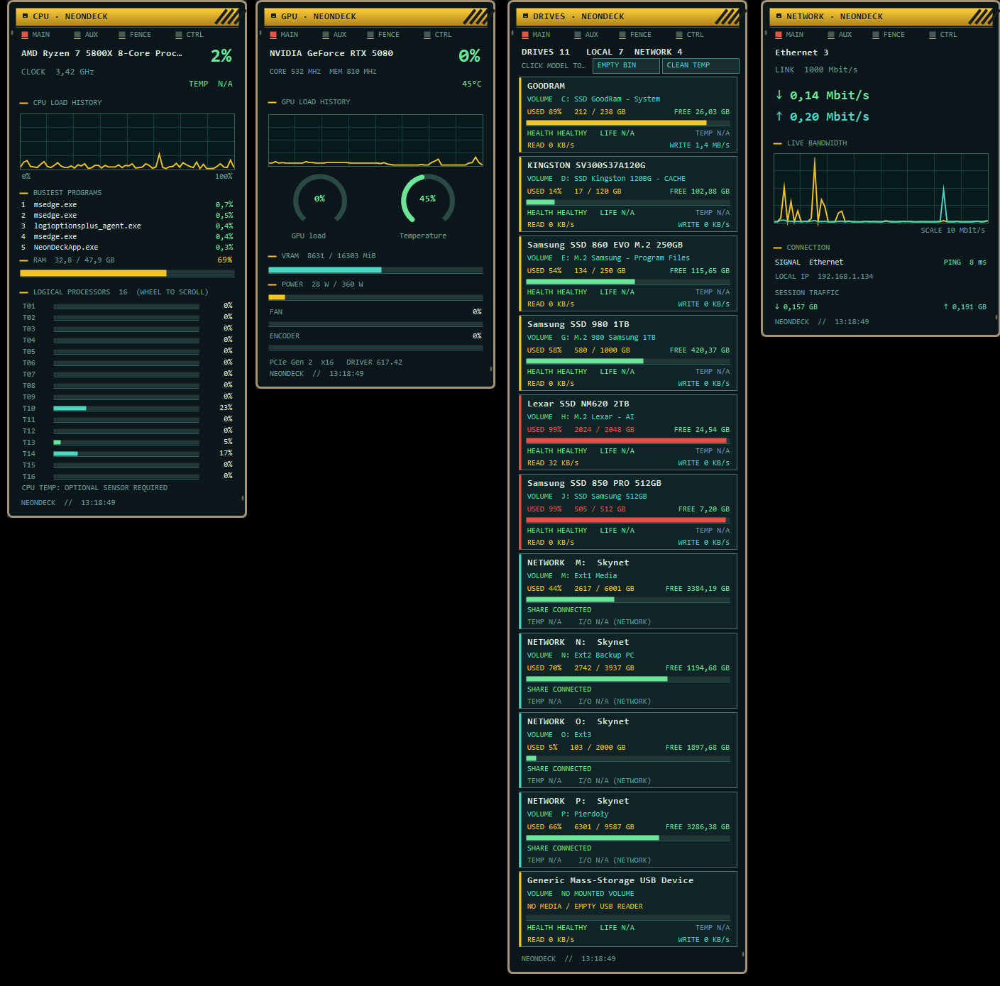

# NeonDeck — Portable Desktop Gadgets for Windows 11


**NeonDeck** is a customizable, no-installer desktop dashboard that shows CPU, NVIDIA GPU, network and storage telemetry in retro-industrial black/teal/yellow panels. Designed for **Windows 11 x64**.

## Screenshot — NeonDeck in action



*Real screenshot of NeonDeck running on Windows 11, showing all four desktop gadgets.*


## Features

| Gadget | Monitoring |
|---|---|
| CPU | Logical CPU threads, aggregate load, clock, RAM, top five busiest processes, history graph |
| GPU | NVIDIA load, temperature, VRAM, power, fan, clocks, encoder, PCIe, chart |
| Network | Adapter, download/upload, live bandwidth graph, ping, IP, Wi-Fi (if supported) |
| Drives | Physical/local and mapped network drives, label, drive letter, model, used/free/total, transfer, optional temperature/SMART |

Other features: custom matching **EXE + system-tray icon**, freely movable desktop gadgets, Always on Top, snapping, locking, start with Windows, saved positions, one-column Drives view, Recycle Bin cleaning and limited temp cleaning.

## Quick start — portable ZIP

1. Extract the release ZIP to a writable folder.
2. Double-click **`NeonDeck.exe`** — not a CMD script.
3. On the first launch, the native launcher compiles and caches `NeonDeckApp.exe` using the Windows .NET Framework compiler if the cache isn't already in the package. Later launches start the cached application directly. GitHub Actions builds a release with both EXEs already compiled.
4. Use the icon beside the Windows clock (may appear under `^`) to show/hide gadgets, change preferences or exit.

**Important:** the `EMPTY BIN` control permanently empties the Recycle Bin without confirmation. `CLEAN TEMP` removes a restricted set of old temporary files; it is not Windows Disk Cleanup.

## Building from source on Windows 11

Requirements: .NET Framework 4.x C# compiler (`csc.exe`, already present on many Windows systems) and **Go 1.21+** for rebuilding the native launcher.

```powershell
.\scripts\build_windows.ps1
```

This generates `dist/NeonDeck_Windows11_Portable_v1.5.0.zip`, containing both precompiled EXEs and data. The native launcher icon resource `.syso` is already included. To re-generate the icon resource from `NeonDeck.ico`, see `scripts/make_icon_and_syso.py` (Pillow required; review output before replacing the existing icon).

A GitHub Actions workflow (`Build Windows Portable`) compiles the native launcher and .NET dashboard on a Windows runner. Run it from **Actions > Build Windows Portable > Run workflow**, then download the artifact. You can publish it as a GitHub Release afterward.

## Hardware sensors

For CPU/SSD temperatures, optionally run [LibreHardwareMonitor](https://github.com/LibreHardwareMonitor/LibreHardwareMonitor) with WMI sensors enabled. Some hardware doesn't expose temperature, SMART wear or per-disk throughput: unsupported values show **N/A**. Network drives do not expose remote physical drive temperatures.

## Project files

- `NeonDeck.cs` — the dashboard (C# WinForms)
- `launcher/main.go` — native Win64 GUI EXE launcher
- `launcher/rsrc_windows_amd64.syso` — executable icon resources
- `NeonDeck.ico` — multi-size branded icon used for both launcher and tray
- `Smart.ps1` — Windows storage health helper
- `scripts/build_windows.ps1` — full Windows build / release ZIP
- `.github/workflows/build-windows.yml` — CI build
- `docs/README_PL.md`, `docs/README_EN.md` — usage and troubleshooting

## License

MIT — see [LICENSE](LICENSE).

## Development status

**v1.5.0** is a test release. The native Windows x64 launcher has been cross-compiled and verified to contain icon resources, but this environment couldn't run the WinForms GUI on Windows 11. Test the built program on Windows before publishing it as stable.
